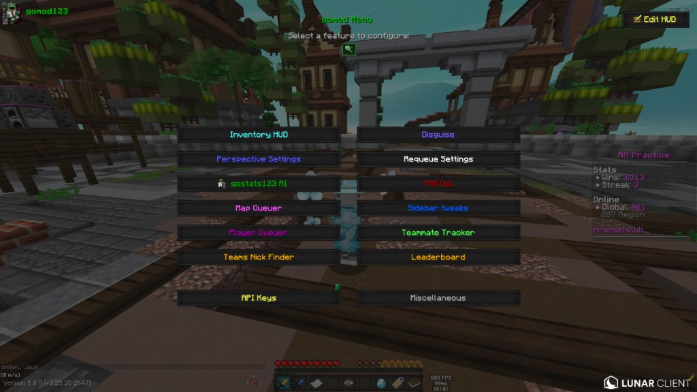
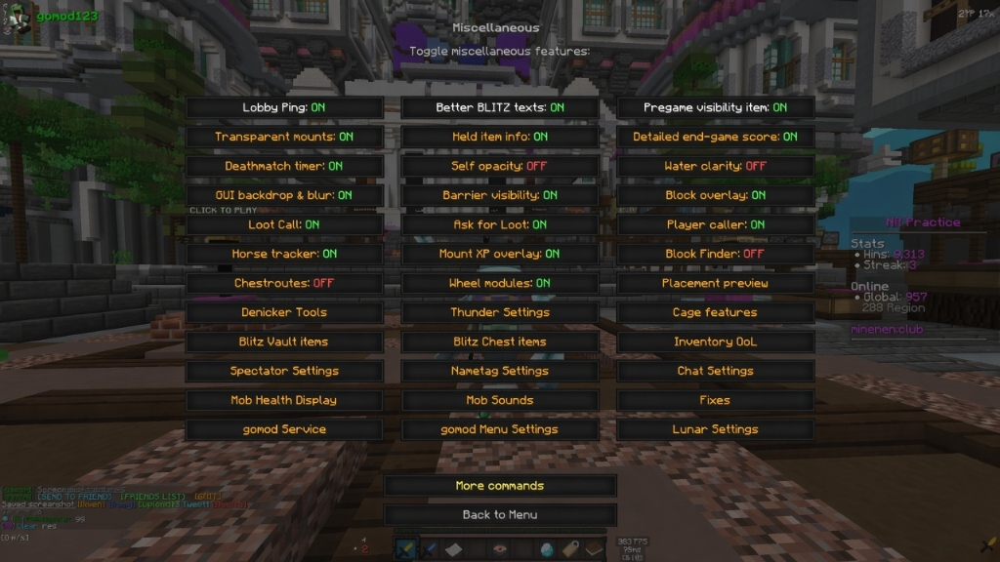
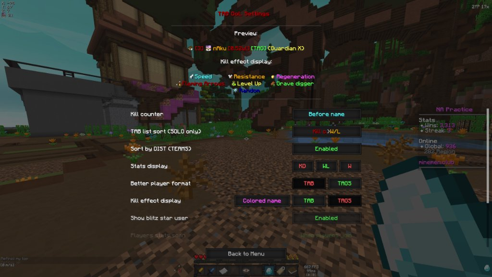
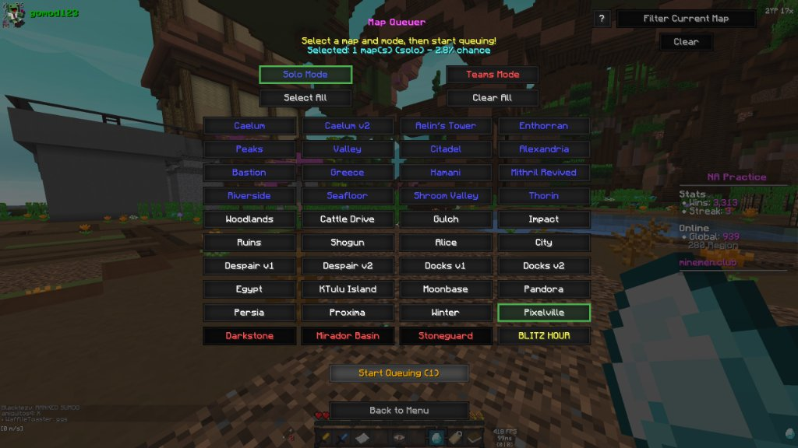
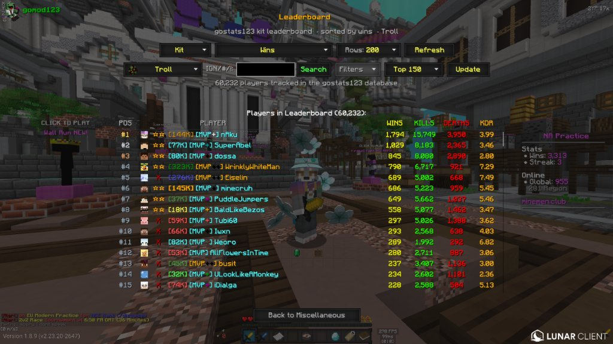
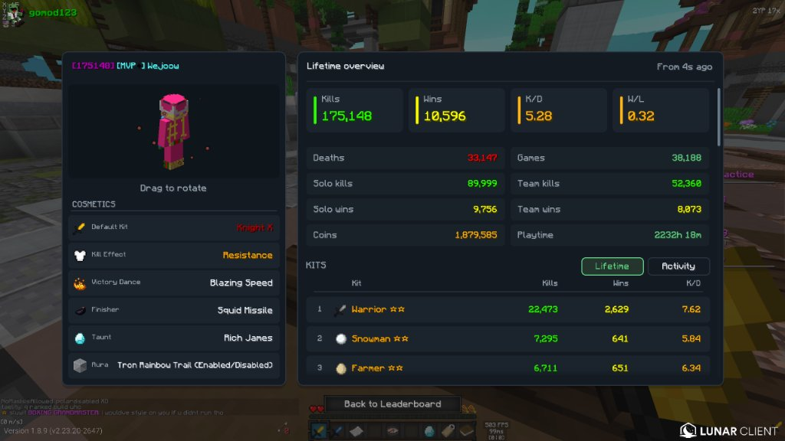
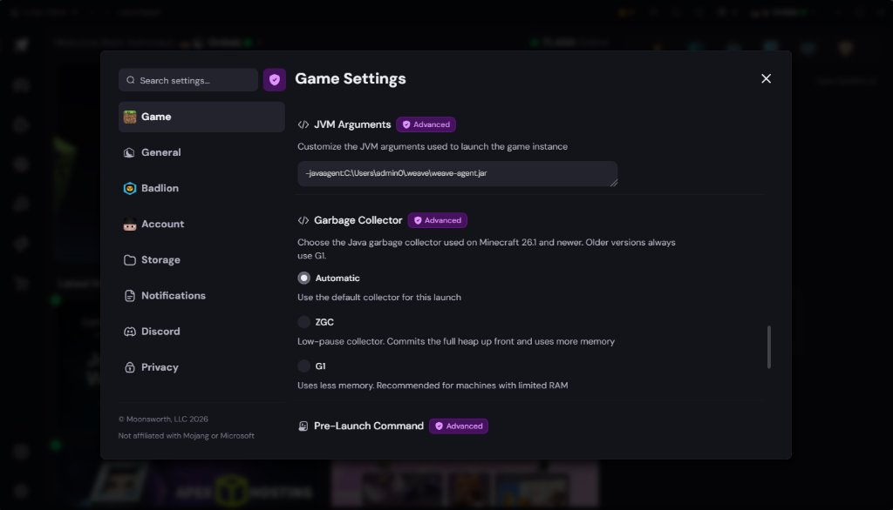

<div align="center">


# gomod123

**50+ utilities, HUDs, and QoL tools for Hypixel Blitz Survival Games on Minecraft 1.8.9.**

[](https://www.minecraft.net/)
[](https://github.com/Napim/gomod123/releases)
[](https://github.com/Napim/gomod123/releases/latest)
[](https://discord.gg/nqcZyyWusP)

**[Download Latest Release](https://github.com/Napim/gomod123/releases/latest)** • **[Join Discord](https://discord.gg/nqcZyyWusP)** • [Preview](#preview) • [Features](#features) • [Installation](#installation) • [Quick Start](#quick-start) • [FAQ](#faq)

</div>

---

## Preview

<p align="center">
  
</p>

| Miscellaneous | TAB QoL Settings |
| :---: | :---: |
|  |  |

| Map Queuer | gostats123 Leaderboard |
| :---: | :---: |
|  |  |

<p align="center">
  
</p>

---

## Features

`gomod123` packs **50+ built-in modules and tools**, all searchable from a single menu (**`ESC` → `gomod`** or `/gomod`).

- **TAB QoL & Kill Counter:** Live kill tracking, enemy kit and Prestige I/II detection, Blitz Star tracking, kill effect indicators, smart TAB sorting, and detailed post-game results.
- **gostats123 Stats & Profiles:** Look up Blitz SG player profiles, kit leaderboards, kit levels, and recent opponents directly in-game.
- **Map Queuer, Player Queuer & Auto Requeue:** Filter your favorite Blitz maps, set pre-start queue rules, and auto-requeue with separate Solo and Teams delays.
- **Blitz Chest & Vault Tools:** Built-in browsers for Blitz chest loot tables, Vault items, enchantment level/chance insights, and custom per-map chest routes.
- **Inventory HUD & Combat Visuals:** Live Inventory HUD, Best Armor and Useless Item highlights, Held Item Info, Deathmatch Timer boss bar, and Mob Health Display.
- **Team & Match Utilities:** Teammate Tracker, Friend Inventory HUD, Loot Call, Ask for Loot, Player Caller, Teams Nick Finder, and Denicker Tools.

---

## Installation

Download the latest release for your loader from the [**Releases**](https://github.com/Napim/gomod123/releases/latest) page.

### Option 1: Minecraft Forge 1.8.9
1. Install **Minecraft Forge 1.8.9**.
2. Download `gomod123-forge-<version>.jar`.
3. Drop the `.jar` into your `.minecraft/mods/` folder.
4. Launch Minecraft 1.8.9 with your Forge profile.

### Option 2: Weave (Lunar Client 1.8.9)
1. Open File Explorer and go to `C:\Users\%USERNAME%` (your Windows user folder, the same place `.lunarclient` is located, **not** inside `.lunarclient`).
2. Create a new folder named `.weave`, then open it and create a `mods` folder inside it.
3. Download the latest **Weave Agent** `.jar` from [Weave-Loader Releases](https://github.com/Weave-MC/Weave-Loader/releases), rename it to `weave-agent.jar`, and place it directly inside `.weave`.
4. Download `gomod123-lunar-<version>.jar` from the [Releases](https://github.com/Napim/gomod123/releases/latest) page and place it inside `.weave\mods`.
5. Launch Lunar Client with Weave using either method below (or see the [Discord guide](https://discord.com/channels/1254469815918133318/1525247712558186657)):

<details>
<summary><strong>Method A: JVM Arguments (Recommended, launches normally from Lunar Launcher)</strong></summary>

<br />

1. Open **Lunar Client Launcher** → **Settings** → **Game** → **JVM Arguments**.
2. Add the following argument (replace `YOUR_USERNAME` with your Windows username):
   ```
   -javaagent:C:\Users\YOUR_USERNAME\.weave\weave-agent.jar
   ```
3. Launch Lunar Client normally from its launcher and your Weave mods will load automatically.

<p align="center">
  
</p>

</details>

<details>
<summary><strong>Method B: UmbraWeave Launcher</strong></summary>

<br />

1. Download `UmbraWeave.exe` from [UmbraWeave Releases](https://github.com/SlxrddTV/UmbraWeave-loader/releases) and open it.
2. Launch Lunar Client normally by clicking **LAUNCH GAME**, then wait **4-8 seconds**.
3. Click **LOAD WEAVE** in UmbraWeave. Lunar Client will close and automatically relaunch with Weave loaded.

*Note: With UmbraWeave, repeat steps 1-3 each time you launch the game (or use Method A above to launch straight from the Lunar Launcher).*

</details>

---

## Quick Start

| Action | How |
| --- | --- |
| Open the main menu | Press **`ESC`** and click **`gomod`**, or type `/gomod` in chat |
| Search any setting | Use the **search bar** at the top of the gomod menu |
| Move HUD elements | Click **Edit HUD** in the top-right corner of the gomod menu |
| Browse extra commands | Open **`gomod` → `Miscellaneous` → `More Commands`** |

---

## FAQ

**What is gomod?**

gomod123 is a Forge/Lunar mod with a bunch of Blitz SG utils and QoL features.

**I don't play Blitz SG. Is this useful for me?**

There are still some Hypixel features and vanilla modules you can use, but it's mainly made for Blitz SG.

**Is gomod a hack?**

No, gomod123 isn't meant for an unfair advantage, but rather to give you a better Blitz experience.

**Why aren't some Blitz features working?**
Make sure your Hypixel language is set to English (`/language english`). Chat-based features like Kill Counter, Auto Requeue, Map/Player Queuer, and Blitz/Deathmatch timers require English Hypixel chat.

---

## Note

As with any Minecraft client modification, use it at your own discretion.

Need help or want to report a bug? Open an [Issue](https://github.com/Napim/gomod123/issues) or join the [Discord](https://discord.gg/nqcZyyWusP).

## License

Licensed under the [**GNU General Public License v3.0**](LICENSE).
